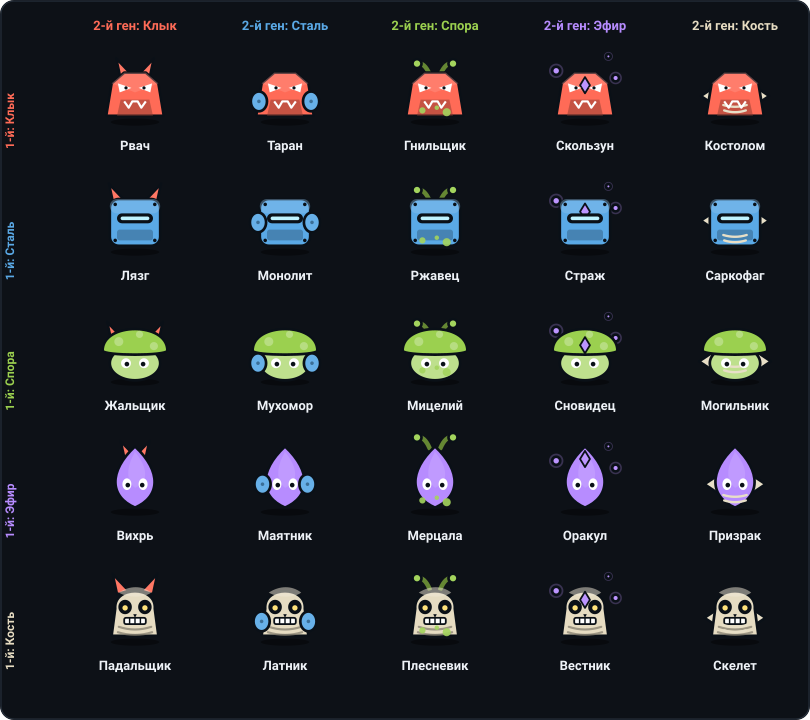

<div align="center">



# 🧬 Геномная арена

**Скрещивай мутантов. Собирай команду. Побеждай друзей и боссов.**

[](https://t.me/genomebreadbot/arena)


Теги:


</div>

---

## 🎮 О игре

**Геномная арена** — пошаговая игра про мутантов, которая работает прямо в Telegram. У каждого мутанта **два гена**, и от их сочетания зависят его вид, характеристики и спецприём. Скрещивай бойцов, получай потомков с новыми комбинациями генов, собирай команду из трёх и выходи на арену.

👉 **[Открыть игру: t.me/genomebreadbot/arena](https://t.me/genomebreadbot/arena)**

## ⚔️ Бои: каждый раз новый

Режимы боя сменяют друг друга, так что скучать не придётся.

| Режим | Что происходит |
|---|---|
| 🎯 **Тренировочный полигон** | Враги на 1–2 уровня слабее твоей команды. Даёт опыт, а каждая победа подряд добавляет +10% к опыту (максимум ×2) |
| ⚔️ **Стадии арены** | Бесконечная лестница стадий. Враги случайные и с каждой стадией сильнее. Твой рекорд попадает в рейтинг |
| 💀 **Боссы** | Каждая 5-я стадия: усиленный враг и сильный мутант в команде босса |
| 🤝 **Дуэль с другом** | Выбери команду, отправь ссылку-вызов, и друг будет сражаться против неё |

В бою: **удар по цели**, **спецприём** с перезарядкой, **автобой** и **отступление**.

## 💥 Эффекты атак

У каждого гена свой визуальный стиль удара:

| Ген | Как выглядит атака |
|---|---|
| 🔴 **Клык** | Подбегает и кусает: челюсти захлопываются на враге, вспышка и искры. Спецприём: два укуса подряд |
| 🔵 **Сталь** | Энергетический снаряд летит по дуге и взрывается кольцом ударной волны. Спецприём: залп по всем врагам |
| 🟢 **Спора** | Заряд и зелёный лазерный луч. Спецприём: ещё и ядовитые пузыри |
| 🟣 **Эфир** | Подбрасывает врага фиолетовой колонной и бьёт об землю. Спецприём: лечащее кольцо и искры на раненом |
| ⚪ **Кость** | Кость вырастает из-под земли и бьёт снизу. Спецприём: ещё и лечит |

Цифры урона показывают силу удара: **белая** обычный урон, **жёлтая** сильный (враг слабее к твоему гену), **серая** слабый, **зелёная** лечение или яд.

## 🧪 Гены

Пять генов, пять спецприёмов и круг «кто кого бьёт»:

| Ген | Спецприём | Эффект |
|---|---|---|
| 🔴 **Клык** | Рывок | Двойной удар по одной цели |
| 🔵 **Сталь** | Залп | Удар по всем врагам, 80% силы |
| 🟢 **Спора** | Яд | Слабый удар и яд на 3 хода |
| 🟣 **Эфир** | Исцеление | Лечит самого раненого союзника |
| ⚪ **Кость** | Вампиризм | Сильный удар, лечит себя на половину урона |

```
Клык → Спора → Эфир → Сталь → Кость → Клык
```

Стрелка означает «бьёт сильнее».

Два гена дают **25 видов мутантов**. Первый ген задаёт тело, второй добавляет детали: рога, щиты, грибные усики или ребра.

<div align="center">

</div>

<details>
<summary><b>Названия всех 25 видов</b></summary>

<br>

| 1-й ген ↓ · 2-й ген → | 🔴 Клык | 🔵 Сталь | 🟢 Спора | 🟣 Эфир | ⚪ Кость |
|---|---|---|---|---|---|
| 🔴 **Клык** | Рвач | Таран | Гнильщик | Скользун | Костолом |
| 🔵 **Сталь** | Лязг | Монолит | Ржавец | Страж | Саркофаг |
| 🟢 **Спора** | Жальщик | Мухомор | Мицелий | Сновидец | Могильник |
| 🟣 **Эфир** | Вихрь | Маятник | Мерцала | Оракул | Призрак |
| ⚪ **Кость** | Падальщик | Латник | Плесневик | Вестник | Скелет |

</details>

## 🧬 Скрещивание и прокачка

- Потомок берёт **по одному гену от каждого родителя**.
- **Шанс мутации 8%**: один из генов появляется из ниоткуда.
- Каждое поколение даёт **+8% к силе** (до 5-го).
- Мутантов можно прокачивать за монеты, отпускать или убирать в архив.
- Лаборатория приносит монеты, пока ты не в игре. Копит до 8 часов, потом ждёт, когда ты зайдёшь.

### Тиры и слияние

Мутантов можно сливать в тир выше. Каждый тир добавляет **+25% к здоровью и атаке**:

`Обычный` → `🥉 Бронзовый` → `🥈 Серебряный` → `🥇 Золотой` → `💎 Платиновый`

## 🎁 Прогресс и награды

- **Бинго видов**: закрашивай клетки таблицы 5×5 новыми видами. Собранные линии дают монеты и постоянные бонусы (например, дешёвое скрещивание или +10% монет за победу).
- **Ежедневные задания** и **серия входов** на 7 дней.
- **Друзья**: награда за каждого приглашённого по реферальной ссылке. Чем больше друзей, тем щедрее: 60 монет за первого, 70 за второго, и так далее с шагом 10.
- **Уведомления от бота**: он напишет, когда лаборатория заполнится и когда друг зайдёт по твоей ссылке.

## 🏆 Рейтинг и сезоны

**Общий рейтинг** строится по рекордной стадии арены. В топ-20 видно имена и аватарки игроков.

**Сезонный рейтинг** обновляется каждую неделю: сезон идёт с понедельника 00:00 по Москве. За каждую победу на арене начисляются очки: **10 плюс номер стадии** (стадия учитывается до 500). Чем выше забрался, тем дороже победа.

Чтобы попасть в награды, нужно набрать минимум 50 очков:

| Место | Награда |
|---|---|
| 🥇 1 | 3000 монет, токены 🥉 и 🥈 |
| 🥈 2 | 2000 монет, 2 токена 🥉 |
| 🥉 3 | 1500 монет, токен 🥉 |
| 4–10 | 1000 монет |
| 11–50 | 400 монет |

Награду за прошедший сезон можно забрать в течение четырёх сезонов.

## 🛠 Технологии

- Вся игра в одном файле **`index.html`**: HTML, CSS и JavaScript без сборки и зависимостей
- **Telegram Mini App** (бот `@genomebreadbot`)
- Сервер сохранений, рейтинга, друзей и сезонов: **Cloudflare Worker + D1** (`worker.js`)
- Платежи через **Telegram Stars**

Вне Telegram работает основная игра. Синхронизация, рейтинг, друзья и сезоны работают только когда игра открыта через бота.

### Честный рейтинг

Сервер не верит числам из игры и проверяет каждое сохранение:

- подпись Telegram (`initData`) проверяется на каждом запросе;
- новое сохранение сравнивается с прошлым: сколько побед, монет и опыта можно было набрать за прошедшее время;
- рекордная стадия должна соответствовать силе мутантов;
- невозможные значения (уровни, тиры) скрывают игрока из рейтинга;
- сохранения версионируются (`rev`): если играть с двух устройств, прогресс не затрётся, а вернётся запрос на синхронизацию.

## 📂 Структура

```
├── index.html        # вся игра
├── worker.js         # сервер: Cloudflare Worker + D1
├── docs/
│   ├── battles.svg   # анимированный баннер для README
│   └── species.svg   # все 25 видов мутантов
└── README.md
```

---

<div align="center">

**Попробуй собрать идеальный геном 🧬**

[](https://t.me/genomebreadbot/arena)

</div>
